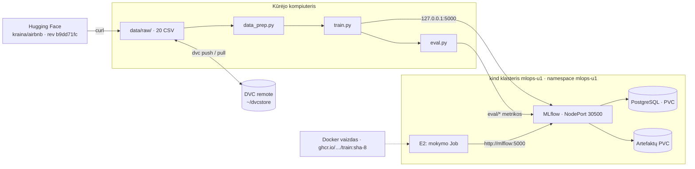

# Architektūra

DVC pipeline'as veikia kūrėjo kompiuteryje, o MLflow serveris (su PostgreSQL ir artefaktų PVC): lokaliame
kind klasteryje. Žali duomenys (20 CSV iš fiksuotos HF revizijos) versijuojami DVC. Kiekvienas mokymas sukuria
MLflow run'ą klasteryje; `dvc.lock` ir run'o `git_commit` / `dvc_raw_md5` tag'ai juos susieja.

